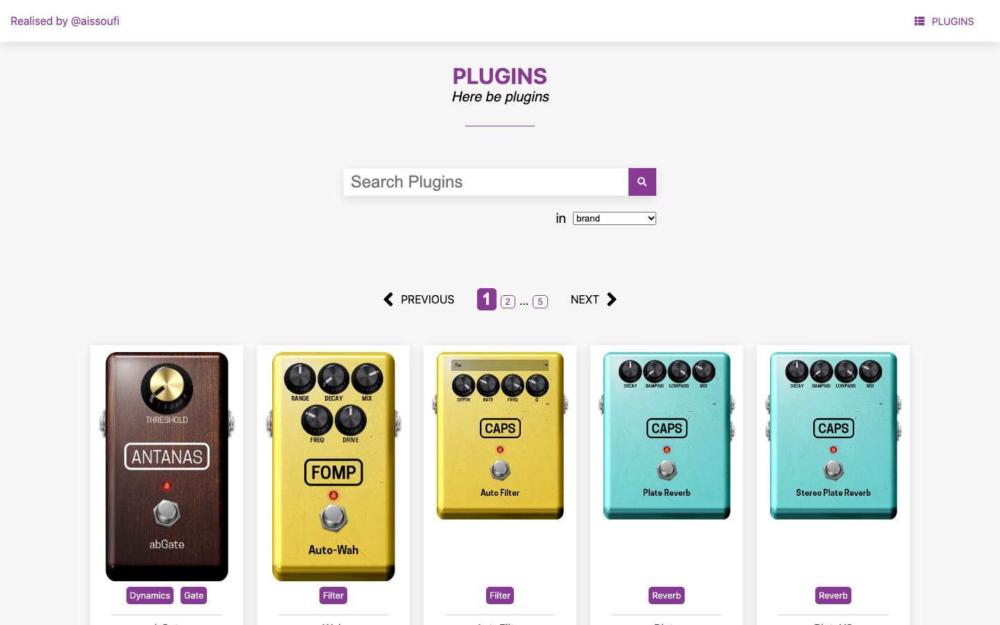

# Pedalboards

A store of audio plugins: virtual effect pedals that visitors browse, search and open one by one.

**Live demo: [pedalboards.issoufi.fr](https://pedalboards.issoufi.fr)**



- The frontend lists the plugins, filters them by brand, category, label or name, and shows the
  details of each one.
- The API online is read only: a Cloudflare Worker on a D1 database
  ([decision record](docs/decisions/0005-cloudflare-pages-and-d1-worker.md)).
- The CMS, which creates, edits and deletes the plugins, stays in the repository but is not
  deployed (see [Deployment](#deployment)).
- The project started in 2018 as a student project. Its tools and architecture since then, with
  the reason for each change, are in [`docs/evolution.md`](docs/evolution.md) and the decision
  records of [`docs/decisions`](docs/decisions).
- AI coding agents maintain the project under its owner's review: see the
  [AI agent workflow](docs/ai-workflow/overview.md).

## Tech stack

- Frontend: React 19, Redux Toolkit 2, React Router 8 and Sass, built with Vite 8 and tested with
  Vitest 5 and Testing Library.
- CMS: React 16 and Sass on Create React App 2, tested with Jest.
- API: Express 5 in a Cloudflare Worker, on a Cloudflare D1 database, tested with Vitest 5 in the
  Workers runtime.
- Hosting: Cloudflare Pages for the frontend, Cloudflare Workers for the API.
- Tooling: Node.js 24, a pnpm workspace, GitHub Actions, ESLint 9 for the frontend, commitlint and
  husky.

## Architecture

| Folder                   | Description                                                                  | Tech        |
|--------------------------|------------------------------------------------------------------------------|-------------|
| pedalboards-frontend     | The web app where visitors browse the plugins ([README](pedalboards-frontend/README.md)) | React, Redux, Sass, Vite, Vitest |
| pedalboards-core-service | The REST API of the plugins ([README](pedalboards-core-service/README.md))   | Express, Cloudflare Workers, D1 |
| pedalboards-cms          | The admin app that creates, edits and deletes the plugins, not deployed      | React, Sass, Create React App |
| tools/commit-messages    | The commitlint rule and the hook script that check the [commit messages](#commit-messages), with their tests | Node.js, commitlint |
| tools/dev-server-check   | The check that a dev server starts and serves its app, with the tests of its helpers | Node.js |
| docs                     | The [history of the project](docs/evolution.md), its [decision records](docs/decisions) and the [AI agent workflow](docs/ai-workflow/overview.md) | Markdown |
| .husky                   | The git hooks that `pnpm install` turns on                                   | husky |

## Run it locally

The conventions that contributors and coding agents follow are in [`CLAUDE.md`](CLAUDE.md).

### Prerequisites

- Node.js 24, the version of [`.nvmrc`](.nvmrc): `nvm use` selects it.
- pnpm 10 or later: it switches by itself to the version of the `packageManager` field of
  `package.json`.

### Install

```bash
pnpm install
```

This installs the dependencies of the three apps of the [pnpm workspace](#pnpm-workspace) and
turns on the [git hooks](#commit-messages).

### Start

```bash
pnpm start
```

- It starts the API on [localhost:8080](http://localhost:8080), the frontend on
  [localhost:3001](http://localhost:3001) and the CMS on [localhost:3002](http://localhost:3002).
- The CMS development server does not start on Node.js 24 yet (see [Node.js 24](#nodejs-24)).

### Test and build

```bash
pnpm test
pnpm build
```

- `pnpm test` runs the tests of the tools and of the three apps once, and `pnpm lint` lints the
  frontend ([decision record](docs/decisions/0008-eslint-flat-config.md)). The CMS has no lint
  until it leaves Create React App ([#45](https://github.com/AIssoufi/pedalboards/issues/45)).
- `pnpm build` builds the frontend and the CMS, and `pnpm --filter pedalboards-frontend preview`
  serves the frontend build.
- The [root scripts](#pnpm-workspace) list the others.

## Core service

- The API is a Cloudflare Worker: Express 5 on a D1 database. `pnpm start:core-service` applies
  the migrations to a local D1, kept in `pedalboards-core-service/.wrangler`, then serves the
  Worker with `wrangler dev` on port 8080, with no Cloudflare account.
- It serves the read routes only: `GET /api/plugins`, `GET /api/plugins/count` and
  `GET /api/plugin/:id`.
- `pnpm start:core-service:local` serves a local API instead, with the write routes of the CMS
  beside them, on a local D1 and an R2 bucket that wrangler simulates. The deployed Worker never
  ships them. The [README](pedalboards-core-service/README.md) of the API describes both.
- The migrations, in `pedalboards-core-service/migrations`, create the `plugins` table and fill it
  with the records of `data/plugins.json`. After a change to that file, run
  `pnpm db:seed:generate` in `pedalboards-core-service` to write the seed migration again.

## pnpm workspace

- The three apps form a pnpm workspace ([`pnpm-workspace.yaml`](pnpm-workspace.yaml)) with a single
  lockfile, `pnpm-lock.yaml`, that `pnpm install` installs from the root or from any app's folder.
- Run a script of one app with `pnpm <script>` in its folder, or with
  `pnpm --filter <app> <script>` from the root (`pnpm --filter pedalboards-cms test`).
- Each app declares every package it imports: unlike npm, pnpm does not put the dependencies of
  dependencies within its reach.

| Root script                 | What it does                                                       |
|-----------------------------|--------------------------------------------------------------------|
| `pnpm start`                | Starts the API (port 8080), the frontend (3001) and the CMS (3002) |
| `pnpm start:<app>`          | Starts one of them: `core-service`, `frontend` or `cms`            |
| `pnpm start:core-service:local` | Starts the API with the write routes of the CMS, on port 8080 |
| `pnpm test`                 | Runs the tests below, then those of the three apps, once           |
| `pnpm test:commit-messages` | Runs the tests of the [commit message](#commit-messages) tools     |
| `pnpm test:dev-server-check`| Runs the tests of the helpers of the dev server check              |
| `pnpm build`                | Builds the frontend and the CMS                                    |
| `pnpm lint`                 | Lints the frontend, which fails on any warning                     |
| `pnpm check:dev-server`     | Checks that the dev server of the frontend starts and serves it    |

- `pnpm start` keeps the other processes running when one of them stops (`--no-bail`), as
  `concurrently` did.
- `pnpm-workspace.yaml` runs no install script of the dependencies (`allowBuilds`), since none is
  needed, and stops pnpm from setting `NODE_PATH` (`extendNodePath: false`), which would hide the
  `NODE_PATH=src/` of the CMS `.env` file from Create React App. `unrs-resolver`, the resolver of
  `eslint-plugin-import-x`, is listed there too: its script only downloads a binary that its
  platform package already installs.
- Its `hoistPattern` keeps ESLint out of the hoisted `node_modules/.pnpm/node_modules`: the
  preflight check of Create React App 2 in the CMS stops the build when it finds there an ESLint
  other than its own, such as the ESLint 9 of the frontend.
- Its `packageExtensions` declare the React peer dependencies that `react-tippy` 1, the tooltips
  of the CMS, leaves out: without them, pnpm would give this package the hoisted React of another
  app rather than the React of the CMS.

## Node.js 24

- The three apps install, test and build on Node.js 24, the current LTS: [`.nvmrc`](.nvmrc) pins it,
  and the `engines` field of every `package.json` requires it.
- The frontend runs on Vite and Vitest
  ([decision record](docs/decisions/0006-vite-and-vitest.md)), so its development server starts
  on Node.js 24, and the CI checks it.
- The development server of the CMS does not start on Node.js 24 yet: `webpack-dev-server` 3 of
  Create React App 2 loads `http-deceiver`, which calls `process.binding('http_parser')`, removed
  from Node.js. It works again when the CMS leaves Create React App
  ([#45](https://github.com/AIssoufi/pedalboards/issues/45)).
- The CMS compiles its styles with Dart Sass, installed under the `node-sass` name
  (`"node-sass": "npm:sass@…"`): `sass-loader` 7 of Create React App 2 only loads a module called
  `node-sass`, and `node-sass` itself has no build for Node.js 24. The frontend installs `sass`
  under its own name, which Vite loads.
- The `start` and `build` scripts of the CMS set `NODE_OPTIONS=--openssl-legacy-provider`:
  webpack 4 hashes modules with MD4, which OpenSSL 3 disables. The alias and the flag go away when
  the CMS leaves Create React App.

## Commit messages

Every commit follows [Conventional Commits](https://www.conventionalcommits.org/) and names its
ticket in a `Refs: PEDAL-<number>` trailer, in the last paragraph of the message, next to
`Co-Authored-By`:

```text
feat(cms): add the pedal editor

Lets the user add, move and remove the pedals of a pedalboard.

Refs: PEDAL-47
Co-Authored-By: Claude <noreply@anthropic.com>
```

- [`commitlint.config.mjs`](commitlint.config.mjs) extends `@commitlint/config-conventional`, so
  the header and the body lines stay within 100 characters, and adds the `ticket-reference-exists`
  rule of [`tools/commit-messages`](tools/commit-messages). Older commits, where a blank line
  follows `Refs:`, still pass.
- Merge commits, `fixup!` and `squash!` commits, the commits signed off by a bot such as
  Dependabot and the release commits (`chore(master): release 1.2.0`) need no reference.
- `pnpm install` turns on two [husky](https://typicode.github.io/husky/) hooks, in
  [`.husky`](.husky):
  - `prepare-commit-msg` adds `Refs: <branch>` on a ticket branch, such as `PEDAL-47`, unless the
    message has a `Refs:` line already or is a merge or `fixup!` commit;
  - `commit-msg` runs commitlint and refuses a message that breaks the rules.
- On another branch, or on a detached HEAD during a rebase, write the trailer yourself.
  `git commit --no-verify` skips the `commit-msg` check, but the CI still checks the commits.
- The [commit messages workflow](.github/workflows/commit-messages.yml) checks every commit of a
  pull request and its title, which needs no reference since the body says `Closes #<number>`.
- Check a message by hand with `printf 'feat: x\n\nRefs: PEDAL-47\n' | pnpm exec commitlint`.

## Continuous integration

The [CI workflow](.github/workflows/ci.yml) runs on the Node.js version of `.nvmrc` for every pull
request to `master` and every push to `master`, with one job per app, which caches the pnpm store:

| Job          | Steps                                                                           |
|--------------|---------------------------------------------------------------------------------|
| Frontend     | `pnpm install --frozen-lockfile`, `pnpm run lint`, `CI=true pnpm test`, `CI=true pnpm run build`, `pnpm run check:bundle`, `pnpm --workspace-root run test:dev-server-check`, `pnpm run check:dev-server` |
| CMS          | `pnpm install --frozen-lockfile`, `CI=true pnpm test`, `CI=true pnpm run build` |
| Core service | `pnpm install --frozen-lockfile`, `pnpm test`, `pnpm run build`, `pnpm run check:bundle` |

- The core service runs its tests with Vitest in the Workers runtime, against a local D1 that the
  migrations fill. `pnpm run build` bundles the Worker into `dist` without publishing it, and
  `pnpm run check:bundle` fails when that bundle holds a write route or a multipart parser.
- The `pnpm run check:bundle` of the frontend fails when the scripts of its build hold
  development-only code, such as the state checks of Redux Toolkit, or when its `_headers` file
  lacks a security or cache header.
- `CI=true` runs the Jest of the CMS once instead of in watch mode, and turns the lint warnings of
  its build into errors. The frontend runs Vitest once (`vitest run`) and ignores it.
- `pnpm run check:dev-server` starts the dev server of the frontend on a free port, checks that the
  page answers with HTML and each of its scripts with JavaScript, then stops it.
- To reproduce a failing job, run its steps in the app's folder.

The [commit messages workflow](.github/workflows/commit-messages.yml) runs for every pull request
to `master`, and again when its title changes. Its job, Commit messages:

1. installs only the tools of the workspace root, without a pnpm cache:
   `pnpm install --frozen-lockfile --filter pedalboards`;
2. runs `pnpm test:commit-messages`;
3. runs commitlint on the commits of the pull request, then on its title, except for the pull
   requests of bots, such as Dependabot's `Bump x from 1 to 2`, whose commits pass as commits of
   a bot.

Dependabot opens its pull requests each week ([config](.github/dependabot.yml)):

- one per ecosystem (npm, GitHub Actions) for the minor and patch updates, and one per major update;
- one for `eslint` and the `@eslint/*` packages, majors included, since the engine and its
  recommended config move together;
- one for the `@fortawesome/*` packages, majors included, since the core, the icons and the React
  component share their version;
- none for the Create React App 2 tooling of the CMS until
  [#45](https://github.com/AIssoufi/pedalboards/issues/45), security updates included.

## Deployment

The site runs on Cloudflare at [pedalboards.issoufi.fr](https://pedalboards.issoufi.fr), on one
origin ([decision record](docs/decisions/0005-cloudflare-pages-and-d1-worker.md)):

| Part | Host | Built from | Configuration |
| --- | --- | --- | --- |
| Frontend | Pages project `pedalboards` | the repository root, `pnpm --filter pedalboards-frontend build` | [`wrangler.jsonc`](wrangler.jsonc) |
| API | Worker `pedalboards-api` on `pedalboards.issoufi.fr/api/*`, D1 database `pedalboards` | `pedalboards-core-service`, `pnpm run deploy` | [`pedalboards-core-service/wrangler.jsonc`](pedalboards-core-service/wrangler.jsonc) |
| CMS | not deployed | none | none |

- Cloudflare builds and deploys both on each push to `master`, through its GitHub connection:
  Pages for the frontend, Workers Builds for the API. Nothing in GitHub holds a Cloudflare token.
- `pnpm run deploy` applies the D1 migrations that the remote database lacks, then deploys the
  Worker.
- `.env.production` sets `VITE_CORE_SERVICE` to `https://pedalboards.issoufi.fr` for every
  build. The production frontend calls `/api` on its own origin, and the Pages preview
  deployments, on `*.pages.dev`, call it across origins, which the CORS headers of the Worker
  allow. The Preview variables of the Pages settings did not reach the build.
- `.env.production` leaves `VITE_BACKEND` empty too, so the header hides its "Admin Panel"
  link. The CMS and the write routes of the API stay in the repository, and run locally only
  (`pnpm start:core-service:local`).
- [`pedalboards-frontend/public/_headers`](pedalboards-frontend/public/_headers) sets the
  headers that Pages sends with the site: `Strict-Transport-Security`, `X-Frame-Options`, a
  `Permissions-Policy`, a Content Security Policy that only reports its violations in the
  console for now (`Content-Security-Policy-Report-Only`), and a one-year `immutable` cache on
  `/assets/*`, whose file names hold a hash of their content. The Worker sends its own headers.
- Pages answers an unknown path with `index.html`, so deep links such as `/plugin/<id>` load the
  app, except under `/assets/`:
  [`pedalboards-frontend/public/assets/404.html`](pedalboards-frontend/public/assets/404.html)
  answers a missing file there with a 404. A tab opened before a deploy asks for chunks that the
  new build no longer has: when one fails to load, the app reloads the page once, to get the new
  build, and shows its error if the chunk fails again within a minute.
